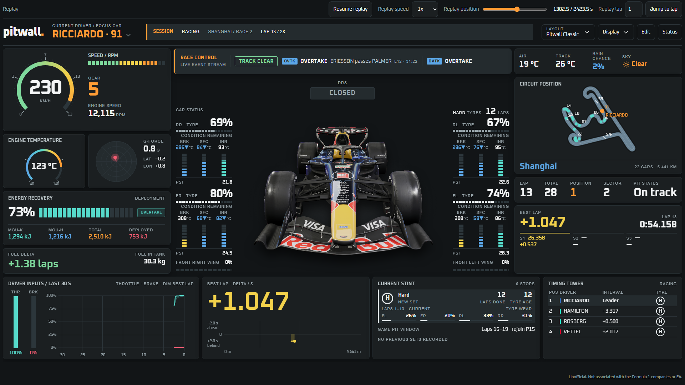
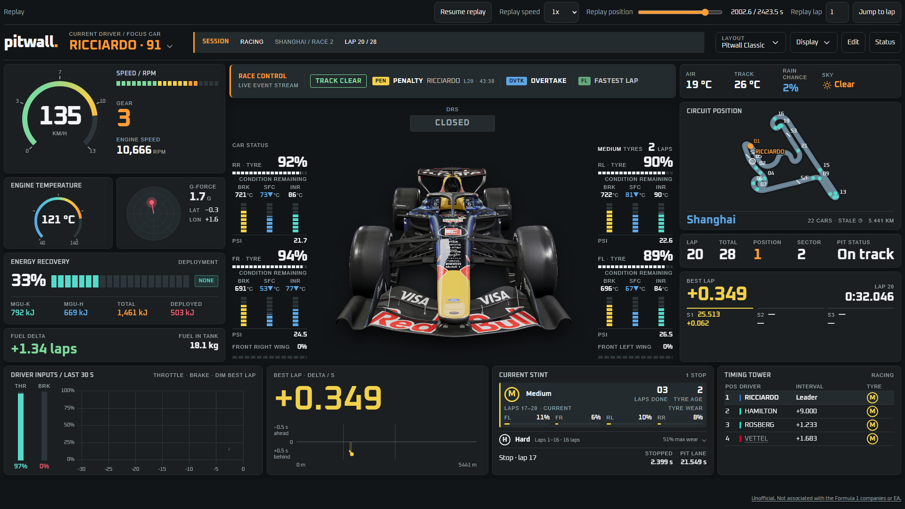

# pitwall

A second-screen race-engineer dashboard for the F1® 25 game, including the 2026 Season Pack.
pitwall reads the game's UDP telemetry, records every session and serves a live dashboard
to any browser on your LAN. It is free and private, and you don't need to install anything.



- **Car and driver:** speed, RPM, gear, engine temperature, G-force, ERS, fuel and driver inputs
- **Tyres and damage:** wear, brake, surface and inner temperatures, pressures, wing damage, DRS
- **Race:** timing tower, lap and sector times, live delta, stint history, pit window, weather, circuit map
- **Race control:** track status, overtakes, penalties and fastest laps
- **Layouts:** presets or your own grid of tiles, with focus car and units chosen per screen
- **Recording and replay:** sessions are saved automatically and can be replayed on every screen



## Install

1. Download the portable Windows x64 build, `pitwall.exe`.
2. Put it in a folder you control, together with `THIRD-PARTY-NOTICES.md`.
3. Run it. A tray icon appears, and the dashboard opens in your browser on the first run.

The binary is unsigned, so Windows may warn you the first time. Only continue for a build
you trust.

| Platform | Prompt | What to do |
| --- | --- | --- |
| Windows | SmartScreen | **More info → Run anyway** |
| Windows | Firewall | Allow access on **Private** networks (needed for other screens and game telemetry) |

## Set up the game

> **Start pitwall before the game.** On Windows the game holds the telemetry port
> exclusively, so pitwall can't bind it if the game is already running.

In the game, open **Settings → Telemetry Settings** and set:

| Setting | Value |
| --- | --- |
| UDP Telemetry | On |
| UDP Format | 2025 or 2026 |
| UDP Port | 20777 |
| UDP Send Rate | 60 Hz |
| UDP IP Address | `127.0.0.1` on the same PC, otherwise the collector PC's LAN IP |

If another app also needs the game's stream, use broadcast mode or pitwall's UDP
forwarding.

## Open the dashboard

| Where | URL |
| --- | --- |
| Collector PC | `http://127.0.0.1:8777` |
| Other screens | The LAN URL or QR code on `http://127.0.0.1:8777/status` |
| Best effort | `http://pitwall.local:8777` (use the IP if it doesn't resolve) |

Use **Layout** to pick a preset and **Edit** to add, move, resize or remove tiles.
**Display** sets the focus car and units for that screen.

- **Security:** there is no login or TLS, so keep pitwall on a trusted LAN. Anyone on the
  network can view and edit layouts. Host controls (replay, settings) only work from a
  loopback URL on the collector PC.
- **iPad:** turn off Auto-Lock for long sessions. Wake Lock isn't available over plain HTTP.
- **OBS:** add a transparent browser source at `?layout=<name>&stream=1` with a custom 60 fps
  frame rate. See [docs/stream-view.md](docs/stream-view.md).

The tray menu shows the receive rate (or **Waiting for game**) and has **Open dashboard**,
**Show QR**, **Settings**, **Open log folder** and **Quit**. If you launch pitwall while it's
already running, it opens the existing dashboard and exits.

## In-game overlay

On Windows, pitwall can float a throttle/brake overlay above the game: a bar for each pedal,
and the last 5 seconds of inputs for the player car.

1. In the tray menu, choose **Throttle/brake overlay**.
2. To place it, choose **Move overlay**. Drag the panel to move it, or drag an edge or the
   corner grip to resize it. Choose **Move overlay** again to lock it. Once locked, it passes
   every click through to the game.

Set the game's display mode to **Borderless** or **Windowed**. Exclusive fullscreen draws over
every other window. The overlay is a separate window and never touches the game process. It
needs the Microsoft Edge WebView2 Runtime, which Windows 11 already includes. pitwall
remembers whether the overlay was on and where you put it.

## Liveries

pitwall ships with a neutral fallback car tinted in team colours. To show real cars, put your
own images in the `liveries/` data folder:

- transparent PNG, 960 × 720, same framing for every car
- named `<teamId>.png`, or `my-team.png` for My Team

Missing images fall back to the shipped car. See the
[livery pack contract](docs/spec/v1.md#13-liveries). Livery art isn't bundled with pitwall, but
you can [download a livery pack](https://drive.google.com/drive/folders/12GbY29onrCgLSuKCoDNeqEA9B2Dj4PB1?usp=sharing)
and copy its images into `liveries/`.

## Recordings and replay

Recording is on by default, and sessions are saved as `.pitrec` files in `recordings/`.

1. On the collector PC, open `http://127.0.0.1:8777/status`.
2. Under **Recordings and replay**, choose **Start replay**. If you copied a file in, choose
   **Rescan recordings** first.
3. On the dashboard, pause, seek, jump to a lap or play at 0.5×, 1×, 2× or 4×.
4. Choose **Stop replay** on the Status page to return to live telemetry.

Replay is shared across all screens. Live telemetry keeps recording in the background.

Convert a raw `.pwcap` capture with the `pitrec` tool:

```powershell
cargo run --locked --bin pitrec -- convert "capture.pwcap" "session.pitrec"
```

For a capture that holds several sessions, add `--uid UID --format 2026` (or `2025`). The
output file must be new, and the source capture is left unchanged.

## Configuration

**Settings** in the tray menu opens `/status`, where you can edit settings. UDP and forwarding
changes apply live. Changing the HTTP address restarts the listener and disconnects screens.

Data folder: `%APPDATA%\pitwall`.

| Path | Contents |
| --- | --- |
| `config.toml` | Settings (opened for editing if startup fails) |
| `layouts.json` | Saved layouts |
| `overlay.json` | In-game overlay on/off, position and size |
| `webview/` | WebView2 data for the in-game overlay (Windows) |
| `recordings/` | `.pitrec` sessions |
| `liveries/` | Your livery images |
| `tracks/` | Track maps |
| `logs/collector.log` | Log, appended across launches |

```toml
[udp]
port = 20777
[http]
port = 8777
bind = "0.0.0.0"
[forward]
enabled = false
targets = []
[recording]
enabled = true
size_cap_gb = 20
[app]
start_with_windows = false   # Windows only, current user
```

Command-line overrides take precedence over `config.toml` and are reapplied on every reload:

| Flag | Purpose |
| --- | --- |
| `--console` | Print diagnostics to the terminal |
| `--udp-port PORT` | Telemetry port |
| `--http-port PORT` | Dashboard port |
| `--bind ADDRESS` | HTTP bind address |
| `--config PATH` | Use this config file (must exist) |
| `--data-dir DIR` | Keep all data in `DIR/pitwall`, for example to run a second, isolated copy |
| `--help` | List all options |

If a port is taken, pitwall keeps running, shows an error and sends a notification naming the
port. Fix the config and it retries.

## Build from source

Requirements: Node 24+, pnpm 11.24.0 and Rust 1.98.0.

```sh
pnpm install --frozen-lockfile
pnpm test && pnpm typecheck
pnpm build                      # build the dashboard first; it is embedded in the binary
cargo test --workspace
cargo build --release --locked --bin pitwall
```

Release builds need `PITWALL_BUILD_ID` set to the source commit SHA for **both** `pnpm build`
and `cargo build`. Debug builds use `dev`. The *Portable release packages* workflow builds both
targets on native runners. It uploads artifacts but doesn't publish a release.

After changing dependencies, regenerate the notices with `python3 tools/notices/generate.py`
(add `--fetch-missing` for new crate licences). More detail is in
[docs/development.md](docs/development.md).

## Notice

pitwall is unofficial and is not associated in any way with the Formula 1 companies. F1, FORMULA ONE, FORMULA 1, FIA FORMULA ONE WORLD CHAMPIONSHIP, GRAND PRIX and related marks are trade marks of Formula One Licensing B.V.

This project is not endorsed by or affiliated with EA or its licensors.

Team names, driver names and other third-party names and marks belong to their respective owners and are used only to identify them.
