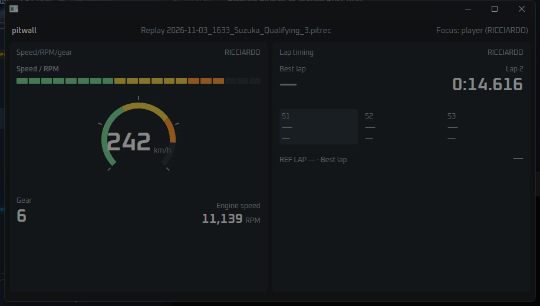

# Native slice 1: gpui window, in-process core, two tiles (#67)

This is the first vertical slice and the ADR 0002 gate. `crates/app` (binary
`pitwall-native`) opens one gpui window and runs the core in the same process. It is fed by
live UDP or by replaying a `.pitrec` recording, and it shows the Speed/RPM/gear and Lap
timing tiles with their readout states and focus-car binding.

**Gate verdict: gpui passes.** It builds on Windows, renders text and custom paint, and
gives us the repaint control we need. The numbers are below. One platform caveat (monitors
asleep) is noted under [Findings](#findings).



The screenshot is darker than the real window: every pixel of the capture, the white
`pitwall` title included, came out dimmed by the same amount.

## What was built

- **Pin.** gpui and gpui_platform come from Zed commit
  `654efae441bc8eb117d0042bb28cd7cf3570bdc9`. The workspace patches `async-task` to Zed's fork
  (`015845a`) because Zed's own `[patch]` is not inherited. `rust-toolchain.toml` pins Rust
  1.98.1 on `x86_64-pc-windows-msvc`, matching the Zed commit. Resolving the gpui tree needed
  `cargo update -p toml@0.8.2 -p proc-macro-crate@2.0.2` (an old lock entry pulled in by the
  collector's `tao`).
- **Core ports (TDD, from the TypeScript tests).** These live in `pitwall_core::readout`
  (READ-01/02), `pitwall_core::binding` (BIND-01..04: identity, participants, labels,
  focus/pinned/ahead/behind resolution, settings parsing, missing-car messages) and
  `pitwall_core::units` (UNIT-01). Tests are in `crates/core/tests/{readout,binding,units}.rs`.
- **Source.** One thread per source publishes through `pitwall_core::feed`. Live UDP uses
  `ingest::udp::LiveUdp` like the collector: it wakes on arrival, publishes the fast path for
  every batch and the snapshot at up to 60 Hz, and publishes anyway every 250 ms while the
  input is idle, so time-driven staleness still shows. Replay ticks `replay::Replay` at 60 Hz
  and publishes only when the position moves.
- **Repaint control.** A `Window::on_next_frame` callback re-registers itself every display
  frame. It compares the feed generations with the ones last drawn and calls `cx.notify()`
  only when they differ. Throttling is off: `inactive_frame_interval`,
  `low_power_frame_interval` and `thermal_frame_interval` are all `None`.
- **Tiles.** Each tile is a pure view model built from core data and unit-tested without a
  window, plus a gpui render. Speed/RPM/gear has converted speed, gear R/N/1–8, grouped RPM,
  a 20-segment strip with a steady limiter at 98.5 %, and a 270° dial painted with
  `PathBuilder` strokes. Densities follow the TS thresholds. Lap timing has the running
  clock, the delta against the best or previous lap, the S1–S3 times and deltas, the Invalid
  mark, the completed result held for 5 s of the next lap, and the reference lap at full
  density.
- **Binding.** Both tiles default to Focus. The header shows the focus car; clicking it
  steps from the player car through each participant and back. Missing cars show "Car not
  in session", "No car ahead" or "No car behind". A retired car still draws, labelled
  Retired.
- **Text.** DirectWrite with Oxanium Regular, SemiBold and Bold TTFs embedded from
  `crates/app/assets/fonts` (OFL; see THIRD-PARTY-NOTICES).

Lap timing in the TypeScript code is declared `rate: 'frame'`, although issue #67 calls it
the "slow tile". Natively, its clock and delta read the slow snapshot, which the source
publishes at up to 60 Hz. Its values therefore move at frame rate, but through the snapshot
path rather than `FastFrame`. `FastFrame` carries no lap time or delta yet.

## Measurements

These measure a release build replaying
`2026-11-03_1633_Suzuka_Qualifying_3.pitrec` (a copy, 15.6 MB, format 2026) from 120 s,
looped. Each run sampled for 30 s after a 6 s warm-up, with tiles at full density.

- **Machine:** AMD Ryzen 7 7800X3D (16 logical CPUs), 15 GB RAM, Radeon RX 6800 plus
  integrated Radeon, Windows 11 Pro 10.0.26300, displays at 165 Hz and 120 Hz.
- **Method:** CPU is the process's `TotalProcessorTime` delta over wall time and includes
  the replay thread. GPU is the sum of `\GPU Engine(pid_*)\Utilization Percentage` over all
  engines, averaged over 1 s samples. Memory is the working set at the end of the run.
  Renders/s and frames/s are counted by the app (`--stats`).

| Run | Window | Active | CPU (one core) | CPU (machine) | GPU avg / max | Working set (peak) | Private | Renders/s (min) | Frames checked/s |
|---|---|---|---|---|---|---|---|---|---|
| full-active | 900×480 | yes | 6.7 % | 0.42 % | 2.0 / 2.2 % | 64 MB (67 MB) | 64 MB | 60.1 (60) | 165 |
| full-inactive | 900×480 | no (shell focused) | 6.5 % | 0.40 % | 2.0 / 2.2 % | 64 MB (68 MB) | 65 MB | 60.1 (60) | 165 |
| large-active | 1600×900 | yes | 6.6 % | 0.41 % | 5.5 / 5.7 % | 64 MB (68 MB) | 86 MB | 60.1 (60) | 165 |

"Renders/s" counts dashboard renders, one per new publish. "Frames checked/s" counts display
frames seen by the generation check: the display refresh rate. The inactive run shows the
throttle is off, because the window keeps 60 renders/s while another window has focus.

Reproduce with:

```text
cargo build --release -p pitwall-native
target\release\pitwall-native.exe --replay <file.pitrec> --from 120 --loop --stats
```

## Findings

- **Monitors asleep cap drawing at about 4 Hz.** gpui's Windows vsync thread waits on
  `DwmFlush`. With the displays powered down by the idle timeout, `DwmFlush` blocked for about
  250 ms per call (measured directly), and the app drew 4 frames a second. gpui handles a
  `DwmFlush` that returns *early* (it falls back to a sleep), but not one that blocks. Once
  the displays woke, `DwmFlush` took 6 ms (165 Hz) and the app drew at 60/s. A race-engineer
  screen is on while in use, so this does not fail the gate, but a "rendering is slow"
  report from an idle machine should be checked against display power first.
- **No frame waker on Windows.** gpui draws only on `WM_PAINT` from that vsync thread. A
  background thread cannot wake a draw directly. Polling the feed generation once per display
  frame costs very little: the 165 checks a second fit inside the CPU figures above.
- **First build.** About 1 min 10 s in debug and 1 min 20 s in release on this machine,
  after the Zed git checkout. Release builds compile HLSL with `fxc.exe` from Windows SDK
  10.0.26100.
- **Text and paint.** DirectWrite renders Oxanium from embedded TTFs. Each dial frame paints
  41 tick paths and up to 4 arc strokes (each arc a 96-segment polyline) at 2 % GPU.

## Not done in this slice

- **Live game data is untested.** The live UDP path is implemented with the same core
  `LiveUdp` and ingest gate as the collector, but no game was running, and binding a UDP
  socket from a new executable would have raised a Windows Firewall prompt on an unattended
  machine. Run it against the game before closing #67.
- **Lap timing parity gaps:** sector rank cues (◆ session best, ● personal best), the
  Time Trial personal-best and rival references (they read as Best for now), and the
  reference-sector row.
- **Speed/RPM/gear:** the dial's thousands labels are not drawn yet.
- **Layout and settings:** the two tiles sit side by side in a fixed layout with default
  settings. There is no grid, layout file, settings UI, unit selector or persisted focus
  yet. Those belong to later tickets.
- **Dependency notices:** THIRD-PARTY-NOTICES covers the embedded font, but the dependency
  list (`tools/notices/generate.py`) has not been regenerated for the gpui tree.
